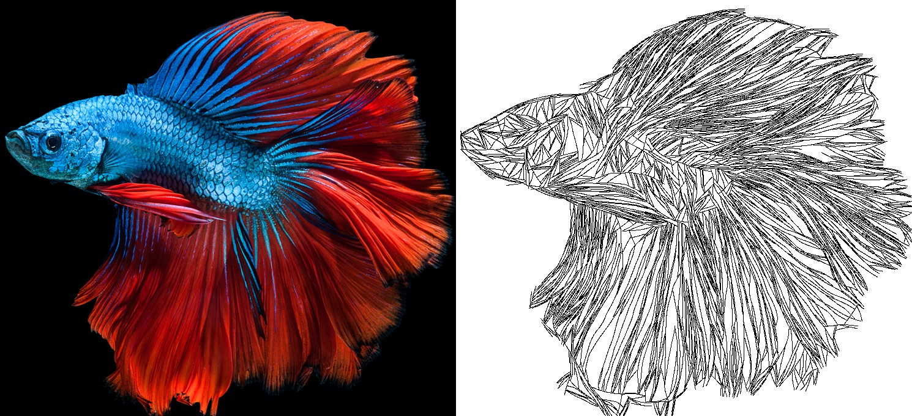
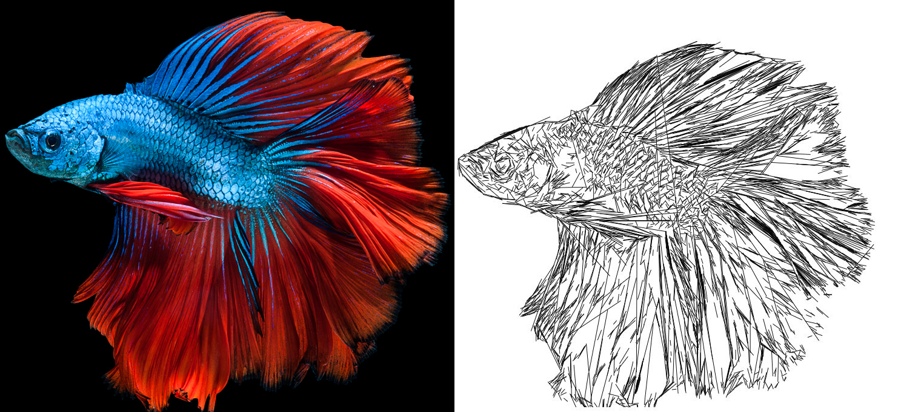
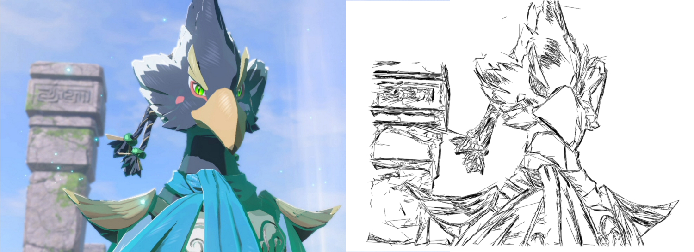
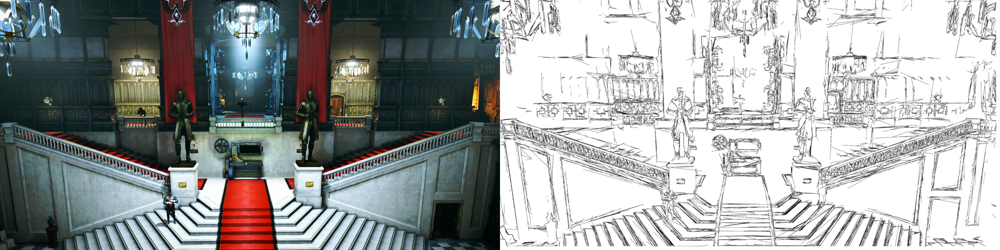
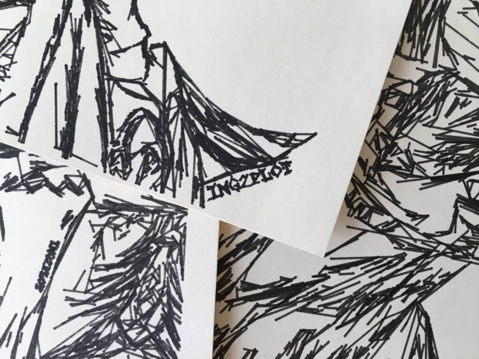

# img2plot
Turn images into drawings for a pen plotter!

## What is this?
img2plot is a script that attempts to make artistic line drawings out of input images, for drawing on a pen plotter.  The script can read most image formats and saves outputs as an SVG file.  

Unlike other image-to-pen-plotter programs, img2plot tries to mimic human drawing styles with lines - instead of drawing densities with stippling, circles, or waves, the output will be lines following edges and sketchy representations of gradients.  The intention is to mimic the appearance of a quick notebook pen sketch.  

Two stroke styles are available:
* `curves` (default) - each stroke is traced along an edge and drawn as a smooth cubic Bezier path, for a looser, more hand-drawn look.
* `lines` - each stroke is a single straight segment; this is the original img2plot style.

This was originally written with a Silhouette Cameo in mind, but many other plotters, laser cutters, or other devices that take vector input ought to work fine.

## How do I use it?
Requires Python 3.10+ and the `matplotlib`, `numpy`, `scipy`, `scikit-image`, and `svgwrite` packages.

With [uv](https://docs.astral.sh/uv/), dependencies are installed automatically on first run:

```
uv run img2plot.py input.jpg -o output.svg
```

Or with pip:

```
pip install matplotlib numpy scipy scikit-image svgwrite
python img2plot.py input.jpg -o output.svg
```

Useful options (run with `--help` for the full list):
* `--style lines` - use the original straight-line style
* `--preview preview.png` - also save a raster preview of the drawing
* `--show` - show the intermediate images (preprocessed input, edge magnitude, gradients) and the result
* `--termination-ratio`, `--min-line-length`, `--max-curve-angle`, `--line-continue-thresh` - control how many strokes are drawn and how long they get
* `--curve-point-spacing` - for curves, larger values give smoother, looser strokes

Then load the SVG into a plotter program of your choice!  (Or anything else, really.)

## Results

Curves:



Lines:






## Future Plans
* Port to C++ / OpenCV for speed on large images
